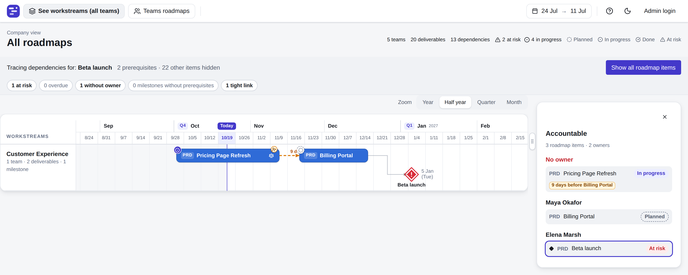
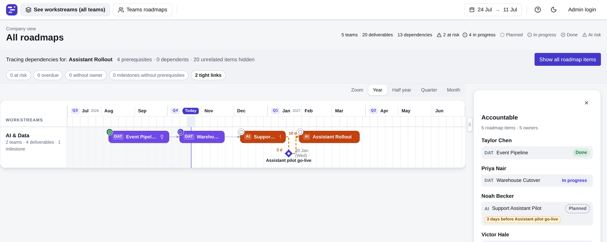

# Overlens

**The delivery and accountability map for engineering organizations.**

The essence is simple: **one person is accountable for one deliverable**, with a date, dependencies, and a scope everyone can see. This is
not another layer on top of Jira or your ticketing system, and connecting to one is not the point. The value is in simplicity and clarity about who is accountable for what.

The installation (on Windows, Mac, or Linux) doesn't require any dependencies, stores all data locally, and works without internet access. You can try it in five minutes on your laptop, and install it inside your company's VPN if you want to try with your teams: 
([Installation](#installation)).


## An example of a problem that Overlens helps solve

The company's most important initiative needs eight teams, from frontend and AI to platform and security. Each team plans in its
own Jira project, in its own way. The frontend team is busy with a modernization and never planned for the initiative. The
platform team learns what the others need only when someone is stuck, and drops its own work to unblock them. Security
hears about it days before launch.

Nobody saw the whole picture until the deadline was close and it was too late. The planning was thin: nobody knew who planned to work on what and when. Teams say they weren't told in time and that the priorities weren't clear. Dates between teams are assumed, not agreed. Scope is scattered across documents. When something slips, it's unclear who owned it.

## Who it's for

Leaders and team leaders who want to plan and monitor how multiple teams contribute to high-level goals, without drowning in detail and low-level tickets. You don't manage tickets; you hold team leads and product managers accountable for what they committed to.

Individual team objectives become unclear when they are scattered and broken down in smaller tickets. These details are essential for team members (engineers) to organize their work, but at the higher level what matters is an aggregate of their work (outcomes) towards company goals.

Transparency and accountability can get hidden inside a ticketing system, so Overlens is open (read-only) to the whole organization, no account needed: everyone sees the same priorities, what their
team owes others, and what it's waiting for. It is meant to be installed inside your company's VPN: simple to deploy, and
no SaaS to subscribe to.

It's also for leaders who would rather ask than search. Connect an AI assistant (via MCP) and ask Overlens in plain words how the work is
progressing and where the risks are.

## What is Overlens

One page that shows who delivers what, by when, and who is waiting on whom. Teams keep working in Jira; this is where the
commitments between teams become visible.



- **Yours, inside your network.** A single program on your own server, with nothing else to install. Your roadmap stays
  in the company unless you choose to connect an AI assistant. Free and open source (MIT).
- **The whole portfolio on one page.** Every team's deliverables and milestones on one company timeline, with status and
  risk at a glance.
- **Dependencies you can see.** Arrows between teams show who waits on whom, and by when. Pick any deliverable and trace
  everything it depends on.
- **Milestones for the meeting.** Switch to milestones only, click one, and see everything that leads to it: who owns
  each part, what is at risk or overdue, what has no owner and where the slack is thin.
- **One accountable owner for every item.** Each deliverable and milestone has one team, one responsible person, a date and
  its scope, all in one place.
- **Ready for the boardroom.** The timeline drops cleanly into PowerPoint and other executive decks.
- **Ask your AI assistant.** Connect Claude, or any other assistant that speaks MCP, and ask in plain words: "What is late
  or at risk, and which teams does it hold up?" It reads the roadmap and never changes it, and every answer links back to
  the page. On a server it stays off until your organisation switches it on; the trial download has it on.



Anyone on the network can view the map without logging in. Logins go only to the leaders accountable for a delivery;
engineers shape the roadmap through their product and engineering leads.

## "Can't we do this in Jira?"

You can build something like it, and many companies try. In practice it rarely holds up. Jira tracks tasks; a leader
needs commitments: which team delivers what, by when, and who is waiting for it. Getting that from Jira means every ticket
must carry the right links, dates, and statuses, so the leader's question becomes extra work for every engineer. The
report looks automatic, but someone keeps it accurate by hand, and nobody owns the answer.

Even Atlassian sells a separate product, [Jira Align](https://www.atlassian.com/software/jira/align), for portfolio
visibility. Meanwhile, Atlassian reports that only 7% of executives say they can quickly see how each of their teams' work
supports company goals.
([Atlassian, State of Teams 2025](https://www.atlassian.com/blog/focus/how-goals-support-strategic-priorities))

Overlens takes the other route: one deliverable, one accountable person, one date, on one page. Teams keep working in
Jira; the commitments between teams live here.

The cost of the alternative, in numbers:

- 87% of knowledge workers say that, with everyone in execution mode, they lack the time or capacity to coordinate.
  Atlassian estimates this fragmentation costs the Fortune 500 $161 billion a year.
  ([Atlassian, State of Teams 2026](https://www.atlassian.com/blog/state-of-teams-2026))
- AI makes coding faster, not coordination: 87% of developers say AI helps them ship faster, yet 72% feel the same or
  more friction than before AI. Finding information is again their biggest source of friction, followed by meetings.
  ([Atlassian, State of Developer Experience 2026](https://www.atlassian.com/blog/development/developer-experience-report-2026))
- 31% of complex projects fail to deliver their intended benefits, more than twice the rate for projects overall.
  ([PMI, Pulse of the Profession 2026](https://www.pmi.org/learning/thought-leadership/driving-success-in-complex-projects))

## Installation

**On your laptop.** Download the build for Mac, Windows or Linux from
[Releases](https://github.com/andrejad/overlens/releases), unpack it and start `roadmap` (on Windows, double-click
`roadmap.exe`). Nothing to install first: no database, no Docker, no accounts. Its window displays the address to open
in your browser. It starts with a sample company, so you can look around straight away; to edit, log in as `admin` with
the password `admin` and change the password.

> **macOS:** version 1.0.0 has not been tested on a Mac yet. The macOS downloads are built the same way as the others and
> should work; if you try one, please tell us how it went in an [issue](https://github.com/andrejad/overlens/issues).

**On a company server, inside your VPN.** When you want your teams to see it, put the same program on a Linux or Windows
server in your network. Again there is nothing else to install: the database and the web interface are built into the
one program.

If your company already runs containers, it fits there too: Docker (with Docker Compose or Portainer), CapRover or
Kubernetes. Every route, step by step, is in [docs/DEPLOY.md](docs/DEPLOY.md).

## Run from source (about five minutes)

You need Go 1.27 and Node 22 with npm.

```
git clone https://github.com/andrejad/overlens.git && cd overlens
export PATH="$HOME/.local/go/bin:$PATH"     # only if Go lives there
cp roadmap.conf.example roadmap.conf        # then set bootstrap_admin_user and bootstrap_admin_password (no defaults)
(cd web && npm install)                     # one time, about a minute
./start.sh                                  # backend on 8080, Vite on 5173; Ctrl+C stops both
```

Open `http://localhost:5173` and log in with the admin you put in `roadmap.conf`. On the first start of an empty database
the app creates a small sample company (five teams, three workstreams, twenty deliverables, five milestones), so you see
something right away; `sample_data: false` in `roadmap.conf` switches that off. Check the server with
`curl localhost:8080/health`.

`./start.sh` runs the Go backend (port 8080) and the Vite frontend (port 5173, proxying `/api` to the backend) together in
one terminal; Ctrl+C stops both gracefully. `./stop.sh` does the same from another terminal (it uses the `.dev-servers.pid`
file that `start.sh` writes, and falls back to whatever holds the two ports).

Other ways to run it:

- `make run` runs only the backend (`go run ./cmd/roadmap -config <repo>/roadmap.conf`); it does not build the frontend.
- `make build` builds the frontend and then the single `roadmap` program with it embedded; `./roadmap` serves both on port
  8080.
- `make dev-data` loads the development company (5 teams, 30 deliverables, `dev/company.json`) into an empty development database.
  It refuses unless `roadmap.conf` has `environment: development` and the database has no team
  yet (set `sample_data: false` in a development config, or the first start creates the sample company and the loader refuses); the loader's `--reset` option first wipes the database after you type `yes` (`make dev-data RESET=1`).
- Running it on a server, in Docker or as a service: see `docs/DEPLOY.md`.

The built binary looks for `roadmap.conf` in its own directory (`-config /path/to/roadmap.conf` overrides
this). Relative `db_path`, `log_dir` and `backup_dir` resolve against the config file's directory, so the
database, logs and backups sit beside the binary (or beside the file given with `-config`), never in the
current working directory. `make run` passes `-config` explicitly because `go run` builds into a temp folder.

The app validates `roadmap.conf` first (a missing or invalid setting prints one ERROR line naming every
problem and exits non-zero; the line is also written to the config's `log_dir`, or to `logs/` beside the
binary if the file cannot be read), then creates/upgrades the SQLite database and serves. Any key can be
overridden with `ROADMAP_<KEY>` (e.g. `ROADMAP_PORT=9000`). It serves `GET /health` and the endpoints in `docs/API.md`; examples to copy are in `docs/API-USAGE.md`. `roadmap -version` prints the version, build time and commit; `make version` prints the version a build gets (`docs/DEPLOY.md`, "Versions").

An optional, read-only connection for AI assistants (MCP at `/mcp`) is off by default; `mcp_enabled: true` switches it
on. See `docs/DEPLOY.md`, "Connecting AI apps".

## Running the tests

- `make test` — the one command: runs every layer (`go vet` + Go tests on a temp SQLite DB per test,
  ESLint (`npm run lint` in `web/`), Vitest, Playwright) regardless of an earlier layer failing, prints a per-layer PASS/FAIL summary,
  always cleans up afterwards — even on failure — and exits non-zero if anything failed.
- `make t AREA=<area>` (same as `make test-focus`) — selects tests by the REQ ID area they prove, not
  by Go package or file location: Go via `go test -run 'REQ_<AREA>_'` (uppercased) across the whole
  module, Vitest via `-t 'REQ_<AREA>_'`, Playwright via `--grep 'REQ_<AREA>_' --no-deps` (so a focus
  run never drags in the full core no-overlap/copies-off suite just to satisfy a project dependency).
  An area with no matching test in a layer is a pass in that layer, not a failure. Areas are the
  lowercase requirement areas: `ovr`, `dat`, `api`, `fe`, `dep`, `auth`, `aud`, `cfg`, `test`, `demo`, `deploy`.
- `make test-clean` — rarely needed; also drops the Go test cache.
- `TEST_SEED=<n> make test-go` (or `TEST_SEED=<n> make t AREA=<area>`) replays a randomised test
  exactly, including its dates — the test clock derives from the seed, never from real "today"; a
  failing test prints its seed.
- Every `make test`/`make t` run gets its own scratch parent directory (`$TMPDIR`, cleaned up by
  `clean-tmp` at the end) so it never touches another worktree's or another concurrent run's live
  test database — only its own `erm-test-*` dirs are ever removed.

Tests never touch the dev or production database: `internal/testutil` builds a fresh DB from
`schema.sql` inside a temp dir and refuses any other path. There is no fixed dataset; tests use the
builders in `internal/testutil/builders.go` with dates relative to the test clock. `schema.sql` is the only
database layout; on start, `store.Converge` adds missing tables and columns to an existing database.

The Playwright projects run in order: `core-no-overlap`, then `core-copies-off`, then the rest; a
failure in a core project stops the suite. Both run against the real app.

## Documentation

- [docs/DEPLOY.md](docs/DEPLOY.md) — every way to run it: download, Linux, Windows, Docker, CapRover, Kubernetes;
  configuration, backups, upgrades and the AI connection
- [docs/API.md](docs/API.md) — the endpoints
- [docs/API-USAGE.md](docs/API-USAGE.md) — examples to copy
- [requirements/](requirements/) — what the app must do, one requirement per line; tests are named after them
- [CHANGELOG.md](CHANGELOG.md) — what changed in each release
- [AGENTS.md](AGENTS.md) — for AI agents: where everything is, how to build and test, the rules for changes

## Licence

MIT, see [LICENSE](LICENSE).
