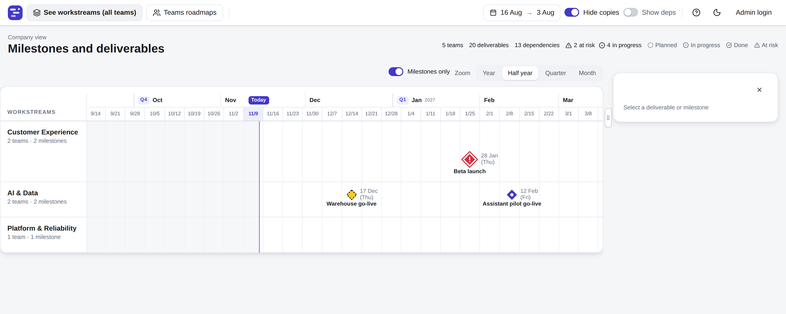
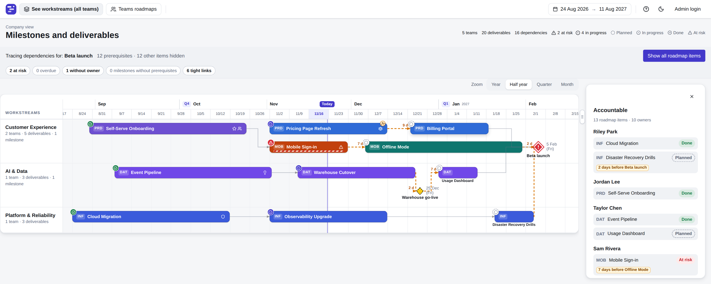
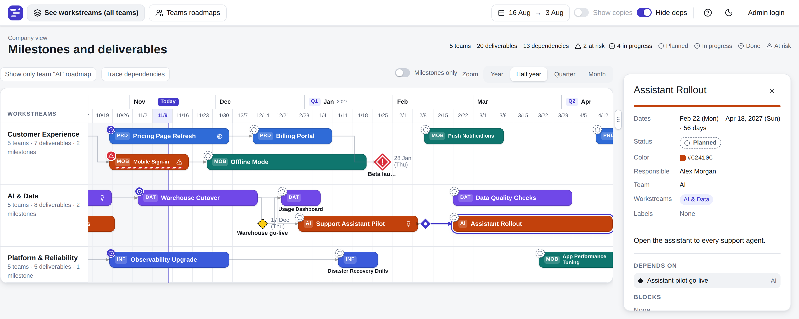

# Overlens

Overlens is for teams and leaders who share large, complex goals that none of them can reach alone, where the work has to be sequenced and one team's progress depends on another's. It's free and open source (MIT).

Every team's deliverables, milestones and dependencies sit on one timeline, each with a date and one accountable owner, so everyone can see what has to happen, by when, and in what order, to reach each milestone, and where things stand right now.

What Overlens is not:
- Not an aggregation layer on top of Jira or other tracking systems.
- Not a task manager or a ticketing system.
- Not a SaaS: it runs on your own server inside your company's network, and you own the data.

## See it in three steps

**1. Start with the milestones.** The dates and goals your company or department commits to, and nothing else.



**2. Open one milestone.** Click a milestone to see only what leads to it: the deliverables it waits on, which team owns it, who is
accountable for each, and which links are tight or at risk. If a team that should be part of it is missing from that picture, or a deliverable has no accountable person, you see it now, not at the deadline.



**3. Then the whole picture.** All teams together: the shared bottlenecks, deliverables that several milestones depend on, and how much each team is carrying at the same time. When a bottleneck slips, you know every goal that slips with it.



## Why Overlens

Ticketing systems are built for tasks. When progress is reported and aggregated through hundreds of tasks and epics,
ownership dissolves into detail and it's difficult to understand who owns the whole outcome. Only 7% of executives say they can quickly see how their teams' work supports
company goals ([Atlassian, 2025](https://www.atlassian.com/blog/focus/how-goals-support-strategic-priorities)).

Portfolio suites such as [Jira Align](https://www.atlassian.com/software/jira/align) are built for this, but they are large
products tied to one vendor's ecosystem. Overlens stays above the teams' own tools. Each team organizes its work as it sees fit,
and what comes together in Overlens is only what they commit to each other and to the company goals.

Overlens is a tool, not a planning process. People still set the goals and agree on who delivers what by when;
Overlens makes the result visible, keeps it current, and shows the moment it stops adding up.

## Ask your AI assistant

Connect Claude or any MCP assistant and ask in plain language, for example "What is late or at risk?" or "What is
Beta launch waiting on?". The assistant can only read; it never changes the roadmap.

## Installation

Overlens is one program: no database to set up, no internet needed.

**Try it on your laptop.** Download the build for Mac, Windows or Linux from
[Releases](https://github.com/andrejad/overlens/releases), unpack it and start `overlens` (on Windows, `overlens.exe`).
Its window shows the address to open. It starts with a sample company; to edit, log in as `admin` / `admin` and change
the password. (The Mac builds are not yet tested on a Mac; please report how it went in an
[issue](https://github.com/andrejad/overlens/issues).)

**Run it for your teams.** Put the same program on a Linux or Windows server inside your network, or run it in
Docker, CapRover or Kubernetes. Every route, step by step, is in [docs/DEPLOY.md](docs/DEPLOY.md).

## Run from source (for developers)

You need Go 1.27 and Node 22 with npm.

```
git clone https://github.com/andrejad/overlens.git && cd overlens
cp overlens.conf.example overlens.conf        # then set bootstrap_admin_user and bootstrap_admin_password (no defaults)
(cd web && npm install)                     # one time, about a minute
./start.sh                                  # Vite on 8080, backend on 8081; Ctrl+C stops both
```

Open `http://localhost:8080` and log in with the admin you put in `overlens.conf`. On the first start the app creates
a small sample company, so you see something right away. Everything else about running from source, and how to run
the tests (`make test`), is in [docs/DEVELOP.md](docs/DEVELOP.md).

## Documentation

- [docs/DEVELOP.md](docs/DEVELOP.md) — run from source, every make command, the tests
- [docs/DEPLOY.md](docs/DEPLOY.md) — every way to run it: download, Linux, Windows, Docker, CapRover, Kubernetes;
  configuration, backups, upgrades and the AI connection
- [docs/API.md](docs/API.md) — the endpoints
- [docs/API-USAGE.md](docs/API-USAGE.md) — examples to copy
- [requirements/](requirements/) — what the app must do, one requirement per line; tests are named after them
- [CHANGELOG.md](CHANGELOG.md) — what changed in each release
- [AGENTS.md](AGENTS.md) — for AI agents: where everything is, how to build and test, the rules for changes

## License

MIT, see [LICENSE](LICENSE).
