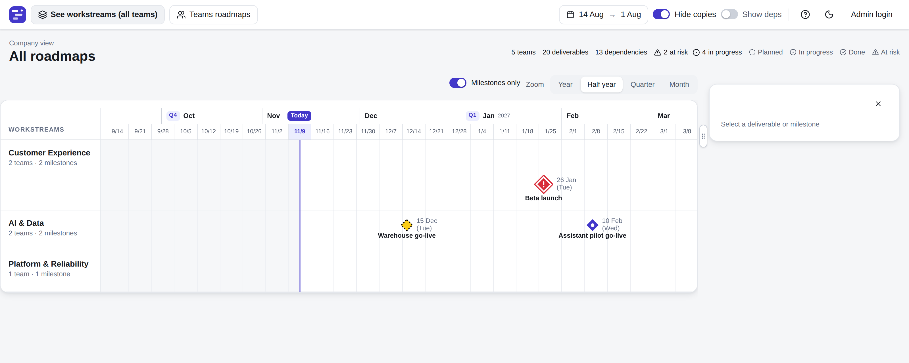
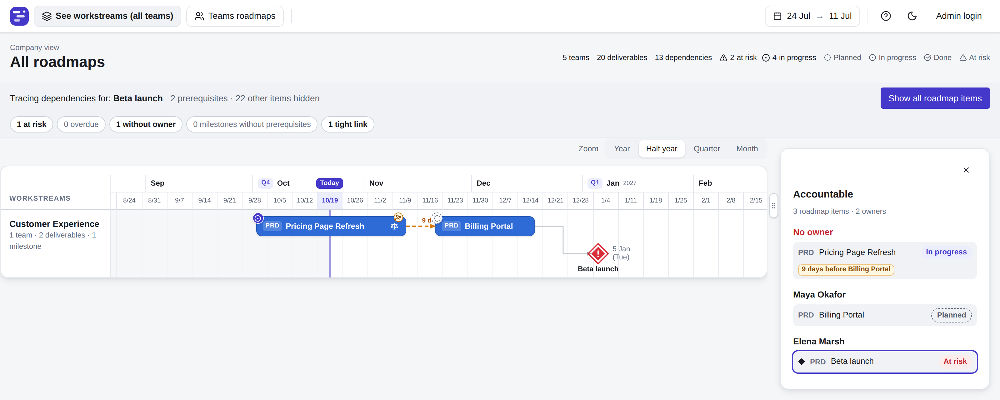
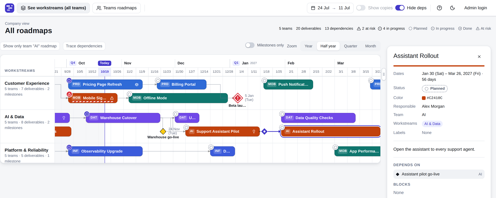
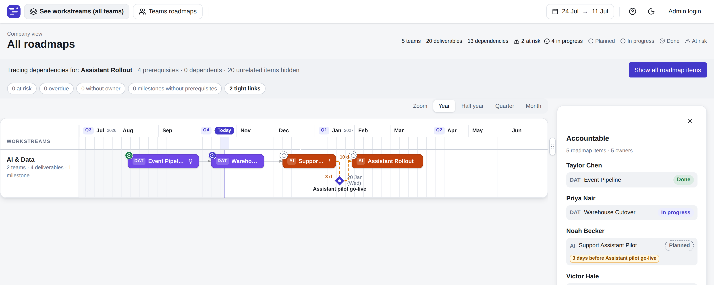

# Overlens

**One page that shows who is accountable for which deliverable, by when, and who is waiting on whom.**

Overlens helps teams working together on complex projects stay transparent and accountable for their part of the work.
Every team's deliverables, milestones and dependencies sit on one timeline, each with a date and one accountable owner.
It is built on one simple rule: one deliverable has exactly one accountable person.

What Overlens is not:
- Not an aggregation layer on top of Jira or other tracking systems.
- Not a task manager or a ticketing system.
- Not a SaaS: it runs on your own server inside your company's network, and you own the data.

## See it in three steps

**1. Start with the milestones.** The dates your company commits to, and nothing else.



**2. Open one milestone.** Click a milestone to see only what leads to it: the deliverables it waits on, who is
accountable for each, and which links are tight or at risk. Everything unrelated is hidden.



**3. Then the whole picture.** Every team's deliverables, milestones and dependencies on one timeline. Select any item
to see its dates, owner and what it depends on.



## Who it's for

Leaders who need to see progress towards company goals, and want everyone to see who is accountable for each step.

Ticketing systems are built for tasks, not high-level objectives. When progress is reported and aggregated through hundreds of tasks and epics,
ownership dissolves into detail and nobody owns the whole outcome. When something slips, teams blame each other for not
being proactive or not sharing information about dependencies. Only 7% of executives say they can quickly see how their teams' work supports
company goals ([Atlassian, 2025](https://www.atlassian.com/blog/focus/how-goals-support-strategic-priorities)).

Portfolio suites such as [Jira Align](https://www.atlassian.com/software/jira/align) may address this, but they are large
products tied to one vendor's ecosystem. Overlens stays at the level that matters to leadership: one deliverable, one
accountable person, one date, visible to the whole organization without an account. Every team is free to organize their
work as they see fit, but their commitments to each other and high-level goals come together in Overlens.

## What you get

- **The whole portfolio on one page**, with status and risk at a glance.
- **Dependencies you can see**: who waits on whom, and everything a deliverable depends on.

  

- **Milestones for the meeting**: what leads to each one, who owns each part, what is late or at risk.
- **Ask your AI assistant**: connect Claude or any MCP assistant and ask in plain language, for example "What is late or
  at risk?" or "What is Beta launch waiting on?". The MCP is read only.
- **Free and open source** (MIT).

## Where it runs

Overlens runs on your company's own infrastructure, so you don't depend on a SaaS vendor. It is one program and needs
nothing but an operating system: no database to set up, no internet. It runs on any Linux or Windows server (VM, EC2,
physical) and on a Mac, and if your company already runs containers, Docker works too.

You can also try it on your own computer first, in five minutes. Read the [Installation](#installation) chapter below.

## Installation

**On your laptop.** Download the build for Mac, Windows or Linux from
[Releases](https://github.com/andrejad/overlens/releases), unpack it and start `overlens` (on Windows, double-click
`overlens.exe`). Nothing to install first: no database, no Docker, no accounts. Its window displays the address to open
in your browser. It starts with a sample company, so you can look around straight away; to edit, log in as `admin` with
the password `admin` and change the password.

> **macOS:** version 1.0.0 has not been tested on a Mac yet. The macOS downloads are built the same way as the others and
> should work; if you try one, please tell us how it went in an [issue](https://github.com/andrejad/overlens/issues).

**On a company server, inside your VPN.** When you want your teams to see it, put the same program on a Linux or Windows
server in your network. Again there is nothing else to install: the database and the web interface are built into the
one program.

If your company already runs containers, it fits there too: Docker (with Docker Compose or Portainer), CapRover or
Kubernetes. Every route, step by step, is in [docs/DEPLOY.md](docs/DEPLOY.md).

## Run from source (about five minutes)

You need Go 1.27 and Node 22 with npm.

```
git clone https://github.com/andrejad/overlens.git && cd overlens
cp overlens.conf.example overlens.conf        # then set bootstrap_admin_user and bootstrap_admin_password (no defaults)
(cd web && npm install)                     # one time, about a minute
./start.sh                                  # Vite on 8080, backend on 8081; Ctrl+C stops both
```

Open `http://localhost:8080` and log in with the admin you put in `overlens.conf`. On the first start the app creates
a small sample company, so you see something right away. Everything else about running from source, and how to run
the tests (`make test`), is in [docs/DEVELOP.md](docs/DEVELOP.md).

## Documentation

- [docs/DEVELOP.md](docs/DEVELOP.md) — run from source, every make command, the tests
- [docs/DEPLOY.md](docs/DEPLOY.md) — every way to run it: download, Linux, Windows, Docker, CapRover, Kubernetes;
  configuration, backups, upgrades and the AI connection
- [docs/API.md](docs/API.md) — the endpoints
- [docs/API-USAGE.md](docs/API-USAGE.md) — examples to copy
- [requirements/](requirements/) — what the app must do, one requirement per line; tests are named after them
- [CHANGELOG.md](CHANGELOG.md) — what changed in each release
- [AGENTS.md](AGENTS.md) — for AI agents: where everything is, how to build and test, the rules for changes

## Licence

MIT, see [LICENSE](LICENSE).
