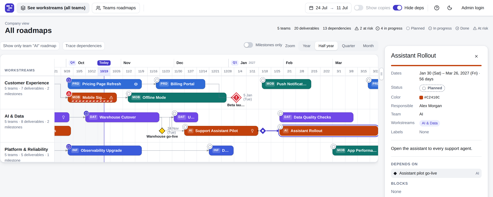

# Overlens

**One page that shows who is accountable for which deliverable, by when, and who is waiting on whom.**

Overlens helps teams working together on complex projects stay transparent and accountable for their part of the work.
Every team's deliverables, milestones and dependencies sit on one timeline, each with a date and one accountable owner.
It is built on one simple rule: one deliverable has exactly one accountable person.

What Overlens is not:
- Not an aggregation layer on top of Jira or other tracking systems.
- Not a task manager or a ticketing system.
- Not a SaaS: it runs on your own server inside your company's network, and you own the data.



## Who it's for

Leaders who need to see progress towards company goals, and want everyone to see who is accountable for each step.

Ticketing systems are built for tasks, not high-level objectives. When progress is reported and aggregated through hundreds of tasks and epics,
ownership dissolves into detail and nobody owns the whole outcome. When something slips, teams blame each other for not
being proactive or not sharing information about dependencies. Only 7% of executives say they can quickly see how their teams' work supports
company goals ([Atlassian, 2025](https://www.atlassian.com/blog/focus/how-goals-support-strategic-priorities)).

Portfolio suites such as [Jira Align](https://www.atlassian.com/software/jira/align) may address this, but they are large
products tied to one vendor's ecosystem. Overlens stays at the level that matters to leadership: one deliverable, one
accountable person, one date, visible to the whole organization without an account. Every team is free to organize their
work as they see fit, but their commitments to each other and high-level goals come together in Overlens.

## What you get

- **The whole portfolio on one page**, with status and risk at a glance.
- **Dependencies you can see**: who waits on whom, and everything a deliverable depends on.
- **Milestones for the meeting**: what leads to each one, who owns each part, what is late or at risk.
- **Ask your AI assistant**: connect any MCP assistant and ask "What is late or at risk?" (read-only).
- **Free and open source** (MIT).

## Where it runs

One program, nothing else to install, no internet needed. It runs on any Linux or Windows server (VM, EC2, physical)
and on a Mac. Try it on your laptop in five minutes: [Installation](#installation).

## Installation

**On your laptop.** Download the build for Mac, Windows or Linux from
[Releases](https://github.com/andrejad/overlens/releases), unpack it and start `roadmap` (on Windows, double-click
`roadmap.exe`). Nothing to install first: no database, no Docker, no accounts. Its window displays the address to open
in your browser. It starts with a sample company, so you can look around straight away; to edit, log in as `admin` with
the password `admin` and change the password.

> **macOS:** version 1.0.0 has not been tested on a Mac yet. The macOS downloads are built the same way as the others and
> should work; if you try one, please tell us how it went in an [issue](https://github.com/andrejad/overlens/issues).

**On a company server, inside your VPN.** When you want your teams to see it, put the same program on a Linux or Windows
server in your network. Again there is nothing else to install: the database and the web interface are built into the
one program.

If your company already runs containers, it fits there too: Docker (with Docker Compose or Portainer), CapRover or
Kubernetes. Every route, step by step, is in [docs/DEPLOY.md](docs/DEPLOY.md).

## Run from source (about five minutes)

You need Go 1.27 and Node 22 with npm.

```
git clone https://github.com/andrejad/overlens.git && cd overlens
export PATH="$HOME/.local/go/bin:$PATH"     # only if Go lives there
cp roadmap.conf.example roadmap.conf        # then set bootstrap_admin_user and bootstrap_admin_password (no defaults)
(cd web && npm install)                     # one time, about a minute
./start.sh                                  # backend on 8080, Vite on 5173; Ctrl+C stops both
```

Open `http://localhost:5173` and log in with the admin you put in `roadmap.conf`. On the first start of an empty database
the app creates a small sample company (five teams, three workstreams, twenty deliverables, five milestones), so you see
something right away; `sample_data: false` in `roadmap.conf` switches that off. Check the server with
`curl localhost:8080/health`.

`./start.sh` runs the Go backend (port 8080) and the Vite frontend (port 5173, proxying `/api` to the backend) together in
one terminal; Ctrl+C stops both gracefully. `./stop.sh` does the same from another terminal (it uses the `.dev-servers.pid`
file that `start.sh` writes, and falls back to whatever holds the two ports).

Other ways to run it:

- `make run` runs only the backend (`go run ./cmd/roadmap -config <repo>/roadmap.conf`); it does not build the frontend.
- `make build` builds the frontend and then the single `roadmap` program with it embedded; `./roadmap` serves both on port
  8080.
- `make dev-data` loads the development company (5 teams, 30 deliverables, `dev/company.json`) into an empty development database.
  It refuses unless `roadmap.conf` has `environment: development` and the database has no team
  yet (set `sample_data: false` in a development config, or the first start creates the sample company and the loader refuses); the loader's `--reset` option first wipes the database after you type `yes` (`make dev-data RESET=1`).
- Running it on a server, in Docker or as a service: see `docs/DEPLOY.md`.

The built binary looks for `roadmap.conf` in its own directory (`-config /path/to/roadmap.conf` overrides
this). Relative `db_path`, `log_dir` and `backup_dir` resolve against the config file's directory, so the
database, logs and backups sit beside the binary (or beside the file given with `-config`), never in the
current working directory. `make run` passes `-config` explicitly because `go run` builds into a temp folder.

The app validates `roadmap.conf` first (a missing or invalid setting prints one ERROR line naming every
problem and exits non-zero; the line is also written to the config's `log_dir`, or to `logs/` beside the
binary if the file cannot be read), then creates/upgrades the SQLite database and serves. Any key can be
overridden with `ROADMAP_<KEY>` (e.g. `ROADMAP_PORT=9000`). It serves `GET /health` and the endpoints in `docs/API.md`; examples to copy are in `docs/API-USAGE.md`. `roadmap -version` prints the version, build time and commit; `make version` prints the version a build gets (`docs/DEPLOY.md`, "Versions").

An optional, read-only connection for AI assistants (MCP at `/mcp`) is off by default; `mcp_enabled: true` switches it
on. See `docs/DEPLOY.md`, "Connecting AI apps".

## Running the tests

- `make test` — the one command: runs every layer (`go vet` + Go tests on a temp SQLite DB per test,
  ESLint (`npm run lint` in `web/`), Vitest, Playwright) regardless of an earlier layer failing, prints a per-layer PASS/FAIL summary,
  always cleans up afterwards — even on failure — and exits non-zero if anything failed.
- `make t AREA=<area>` (same as `make test-focus`) — selects tests by the REQ ID area they prove, not
  by Go package or file location: Go via `go test -run 'REQ_<AREA>_'` (uppercased) across the whole
  module, Vitest via `-t 'REQ_<AREA>_'`, Playwright via `--grep 'REQ_<AREA>_' --no-deps` (so a focus
  run never drags in the full core no-overlap/copies-off suite just to satisfy a project dependency).
  An area with no matching test in a layer is a pass in that layer, not a failure. Areas are the
  lowercase requirement areas: `ovr`, `dat`, `api`, `fe`, `dep`, `auth`, `aud`, `cfg`, `test`, `demo`, `deploy`.
- `make test-clean` — rarely needed; also drops the Go test cache.
- `TEST_SEED=<n> make test-go` (or `TEST_SEED=<n> make t AREA=<area>`) replays a randomised test
  exactly, including its dates — the test clock derives from the seed, never from real "today"; a
  failing test prints its seed.
- Every `make test`/`make t` run gets its own scratch parent directory (`$TMPDIR`, cleaned up by
  `clean-tmp` at the end) so it never touches another worktree's or another concurrent run's live
  test database — only its own `erm-test-*` dirs are ever removed.

Tests never touch the dev or production database: `internal/testutil` builds a fresh DB from
`schema.sql` inside a temp dir and refuses any other path. There is no fixed dataset; tests use the
builders in `internal/testutil/builders.go` with dates relative to the test clock. `schema.sql` is the only
database layout; on start, `store.Converge` adds missing tables and columns to an existing database.

The Playwright projects run in order: `core-no-overlap`, then `core-copies-off`, then the rest; a
failure in a core project stops the suite. Both run against the real app.

## Documentation

- [docs/DEPLOY.md](docs/DEPLOY.md) — every way to run it: download, Linux, Windows, Docker, CapRover, Kubernetes;
  configuration, backups, upgrades and the AI connection
- [docs/API.md](docs/API.md) — the endpoints
- [docs/API-USAGE.md](docs/API-USAGE.md) — examples to copy
- [requirements/](requirements/) — what the app must do, one requirement per line; tests are named after them
- [CHANGELOG.md](CHANGELOG.md) — what changed in each release
- [AGENTS.md](AGENTS.md) — for AI agents: where everything is, how to build and test, the rules for changes

## Licence

MIT, see [LICENSE](LICENSE).
